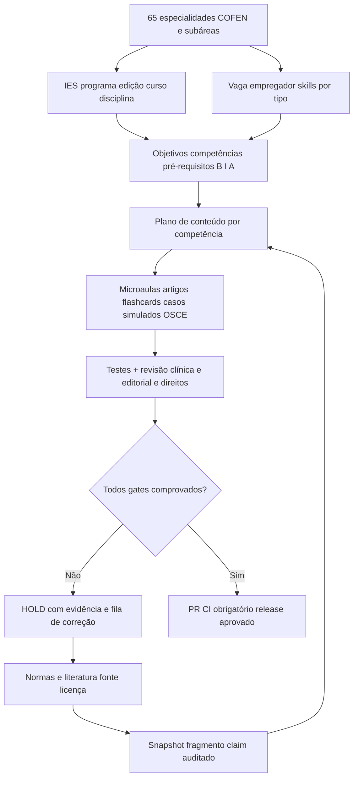

# PLANO MESTRE DE CONCLUSÃO — CKO / NCOS / CONTEÚDO DE ENFERMAGEM

**Versão:** 1.0.0 — 15/11/2026  
**Repositório:** [IndiciumFIN/calculadorasdeenfermagem](https://github.com/IndiciumFIN/calculadorasdeenfermagem)  
**Branch de evidências:** `review/cko-w7-public-evidence-20261114` · [PR #70](https://github.com/IndiciumFIN/calculadorasdeenfermagem/pull/70)  
**EPIC de execução:** [Issue #74](https://github.com/IndiciumFIN/calculadorasdeenfermagem/issues/74)  
**Estado:** PLANO VERSIONADO · AUTOMATIZAÇÃO DETERMINÍSTICA SOB IMPLEMENTAÇÃO · PUBLICAÇÃO CLÍNICA **NO-GO**.

## 1. Objetivo final e fronteira do escopo

Construir, para todas as 65 especialidades principais e 80 subáreas listadas no anexo oficial do Cofen, uma **grade de aprendizagem por competência e nível**, baseada em fontes normativas e institucionais verificáveis, suplementada por **descrições de vagas de trabalho** e por competências identificadas nelas. Produzir e reutilizar conteúdo educacional original do **básico ao avançado**: artigos, microaulas, flashcards, questões, simulados, casos clínicos *fictícios*, OSCE, checklists, apresentações e objetos acessíveis/idiomas previstos no projeto.

A lista Cofen é universo de reconhecimento profissional; **não obriga existência de oferta em cada especialidade**. Curso de graduação é base para ensino; não equivale a especialização. Vaga de emprego é fonte de expectativa do empregador; não substitui norma de exercício profissional ou evidência clínica. O universo curricular completo precisa ser congelado **incluindo CME, Centro Cirúrgico, SRPA e demais áreas**, não limitado aos 1.055 microtópicos de Trabalho e Urgência.

## 2. Diagnóstico inicial medido

| Dimensão | Evidência de 15/11/2026 | Conclusão permitida |
|---|---:|---|
| Especialidades Cofen | **65 entradas principais; 80 subáreas** | Catálogo de descoberta estruturado, homologação curricular não concluída |
| Inventário anterior | **114 programas**; 83 com itens; 31 sem itens, 28 no escopo | Recuperação curricular incompleta |
| Metadados de currículo | **985 átomos** e **1.514 vínculos candidatos**, + **174 ocorrências** USP/Sírio/UFCSPA | Não são claims clínicos nem aprovação semântica |
| Amostra de mercado | **34 anúncios**, 15 perfis; **14/65** entradas com anúncio | Pesquisa exploratória, amostra não probabilística |
| Produção W7 | **38 microaulas, 7 artigos, 59 questões, 38 flashcards, 10 casos, 8 checklists** | Objetos candidatos, ainda não publicados |
| Fontes catalogadas | Drive 118; Supabase 157 no snapshot | Coleções diferentes, conciliação URI/versão/direitos pendente |
| Direitos pendentes | 34 registros Drive `RIGHTS_AUDIT_REQUIRED`; outros com condições/quarentena | Não presumir licença pelo acesso à página |
| Registro Work/Urg | **1.055** microtópicos, 38 rascunhos = **3,60%** | Só cobertura de rascunhos nesse denominador parcial |
| Banco de distribuição | `ce_platform.courses/questions/content_documents` com zero registros no snapshot de 15/11 | Produção GitHub não implantada nesses objetos |
| Segurança | Sete tabelas `cko_evidence` sinalizadas com RLS desabilitado na auditoria | Revisão de grants/exposição P0, sem alterações não autorizadas |
| Integridade de corpus | Divergência de SHA do registro de microtópicos entre cópia atual e W7 anterior | Não afirmar igualdade de corpus sem reconciliação |

**Regra:** não consolidar diferentes denominadores em um “% global” artificial. Cada métrica tem fonte, data, escopo, status e critério próprio.

## 3. Fontes de verdade, identidade e conflitos

1. **Cofen:** especialidade/subárea, versão oficial do anexo e alterações com data (sem confundir uma subárea com uma especialização autônoma). Pareceres específicos e habilitações adicionais são relações normativas distintas.
2. **MEC/IES/hospital de ensino:** programa, instituição, modalidade, campus, coorte/edição, PPC, matriz, disciplina, ementa, bibliografia, CH, estágio e pré-requisitos. A lista declaratória de ofertas de lato sensu no e-MEC não homologa equivalência das disciplinas.
3. **Fontes clínicas:** atos oficiais (MS/Anvisa/Cofen etc.), guias e estudos conforme autoridade, vigência, evidência, licença e qualidade; texto normativo não deve ser confundido com interpretação editorial.
4. **Mercado profissional:** descrição da vaga, ID, URL, empregador, data, região, especialidade, exigido × desejável × responsabilidade × competência comportamental; encerrada/banco de talentos não é vaga ativa. Não fazer inferência nacional a partir de 34 anúncios.
5. **Corpus técnico:** snapshots, fragmentos, claims, linguagem de ontologia e grafo de reutilização; títulos de disciplinas **não** são evidências do conteúdo científico de uma habilidade.
6. **Código/banco:** Git SHA, migração versionada, schema e dicionários canônicos; sem nova biblioteca concorrente. Instâncias históricas ficam com decisão `SUPERSEDED` explícita, nunca apagadas para “limpar duplicidade”.

Chaves de identidade sugeridas: `specialty_id`, `course_provider_id`, `campus`, `program_id`, `cohort/edition`, `curricular_component_id`, `competency_id`, `market_skill_id`, `job_id`, `source_id`, `snapshot_sha256`, `fragment_id`, `claim_id`, `content_object_id`, `review_id`. Nenhuma relação `PART_OF` ganha status aprovado por coincidência lexical.

## 4. Ordem obrigatória da execução (DAG / WO)

### WO-CKO-CURR-20261115-01 — CANONICAL_BASELINE (P0)

**Dono funcional:** DataSteward. **Modo:** `AUTO_RECONCILE_THEN_HUMAN_APPROVAL`. **Estado inicial:** `HOLD_SOURCE_VERSION`. **Dependências:** nenhuma.

**Trabalho:** Reconciliação de hashes do registro de 1.055 microtópicos, programas, direitos e fontes; congelamento de edição/denominadores.

**Entregável:** Manifesto de dados, hashes e decisões de duplicidade; não perder material pré-existente.

**Aceite:** Identidades e versões assinadas; nenhuma correção de fonte por inferência.

### WO-CKO-CURR-20261115-02 — SOURCE_RIGHTS (P0)

**Dono funcional:** RightsAndPrivacy. **Modo:** `AUTO_TRIAGE_PLUS_HUMAN_RIGHTS`. **Estado inicial:** `HOLD_RIGHTS`. **Dependências:** `WO-CKO-CURR-20261115-01`.

**Trabalho:** Direitos de 118 fontes Drive, 157 fontes Supabase, licenças de livros/ementas e permissões por operação.

**Entregável:** Matriz obra × edição × operação × titular × licença × evidência.

**Aceite:** Direitos de cada objeto resolvidos ou hold explícito; zero cópias proibidas.

### WO-CKO-CURR-20261115-03 — SECURITY_PRIVACY (P0)

**Dono funcional:** SecurityAndDataSteward. **Modo:** `AUTO_READONLY_SECURITY_AUDIT`. **Estado inicial:** `HOLD_SECURITY`. **Dependências:** `WO-CKO-CURR-20261115-01`.

**Trabalho:** Análise de RLS/grants Supabase, exposição de fontes e dados sensíveis; nunca executar DDL em produção sem aceite.

**Entregável:** Relatório de risco e testes isolados de políticas/privacidade.

**Aceite:** Revisão formal de permissões e teste de não-exposição.

### WO-CKO-CURR-20261115-04 — SPECIALTY_CURRICULA (P1)

**Dono funcional:** CurriculumReviewer. **Modo:** `AUTO_DISCOVERY_WITH_HUMAN_SYLLABUS_REVIEW`. **Estado inicial:** `IN_PROGRESS_CANDIDATE`. **Dependências:** `WO-CKO-CURR-20261115-01`, `WO-CKO-CURR-20261115-02`.

**Trabalho:** Buscar fontes primárias de currículo por 65 especialidades e 80 subáreas, começando USP/Einstein/Sírio e IES públicas.

**Entregável:** Especialidade ↔ curso ↔ versão ↔ ementas ↔ competências, sem auto PART_OF.

**Aceite:** 65 entradas com evidência curricular ou lacuna justificável por falta de oferta, 28 programas pendentes revisados.

### WO-CKO-CURR-20261115-05 — EMPLOYER_SKILLS (P1)

**Dono funcional:** MarketResearchAndNursingSME. **Modo:** `AUTO_DEDUP_TAXONOMY_WITH_REVIEW`. **Estado inicial:** `IN_PROGRESS_CANDIDATE`. **Dependências:** `WO-CKO-CURR-20261115-01`.

**Trabalho:** Ampliar vagas para 65 entradas com múltiplos empregadores/plataformas, deduplicar por URL/id e codificar exigências.

**Entregável:** Matriz exigido/desejável/responsabilidade/comportamental com citações por vaga.

**Aceite:** Cada especialidade pesquisada, n transparente, casos sem vaga marcados como pesquisa insuficiente.

### WO-CKO-CURR-20261115-06 — SEMANTIC_COMPETENCIES (P1)

**Dono funcional:** OntologyAndKG. **Modo:** `AUTO_CANDIDATE_THEN_HUMAN_DECISION`. **Estado inicial:** `HOLD_SEMANTICS`. **Dependências:** `WO-CKO-CURR-20261115-04`, `WO-CKO-CURR-20261115-05`.

**Trabalho:** Normalizar competência, pré-requisitos, habilidades, levels B/I/A e vínculos com matriz/evidência.

**Entregável:** Grafo com relações tipadas, IDs versionados e audit trail.

**Aceite:** Zero relações promovidas só por similaridade textual; todos pré-requisitos revisados.

### WO-CKO-CURR-20261115-07 — SOURCE_ATOMIZATION (P1)

**Dono funcional:** EvidenceAndSourceVerifier. **Modo:** `AUTO_ALLOWED_PARSING_WITH_CLINICAL_REVIEW`. **Estado inicial:** `HOLD_EVIDENCE_AND_LICENSE`. **Dependências:** `WO-CKO-CURR-20261115-02`, `WO-CKO-CURR-20261115-06`.

**Trabalho:** Processar apenas material permitido, extrair fragmentos e claims, hash/fragment locator, classificar epistemologia.

**Entregável:** Claims atômicos vinculados a fonte/edição e revisão de atualidade.

**Aceite:** 100% claims previstos sustentados ou HOLD, sem misturar 28k átomos históricos e 103 fragments banco.

### WO-CKO-CURR-20261115-08 — CONTENT_FACTORY (P2)

**Dono funcional:** EducationalEditor. **Modo:** `AUTO_DRAFT_WITH_REVIEW`. **Estado inicial:** `IN_PROGRESS_CANDIDATE`. **Dependências:** `WO-CKO-CURR-20261115-06`, `WO-CKO-CURR-20261115-07`.

**Trabalho:** Produzir fundamentos transversais antes de especialidades; artigos, microaulas, quiz, flashcards, casos, OSCE.

**Entregável:** Mapa competência → formatos → claims → fontes; verificações linguísticas e acessibilidade.

**Aceite:** Todos objetivos planejados cobertos por conteúdo autoral submetido à revisão, sem clonagem de texto protegido.

### WO-CKO-CURR-20261115-09 — CLINICAL_EDITORIAL_QA (P2)

**Dono funcional:** ClinicalReviewerAndPedagogyBoard. **Modo:** `AUTOMATED_TESTS_HUMAN_SIGNOFF`. **Estado inicial:** `HOLD_CLINICAL_REVIEW`. **Dependências:** `WO-CKO-CURR-20261115-07`, `WO-CKO-CURR-20261115-08`.

**Trabalho:** Testes, revisão clínica e pedagógica, validação de distratores, OSCE, evidência normativa, direitos.

**Entregável:** Parecer por objeto, decisões não automáticas, testes de regressão e acessibilidade.

**Aceite:** Nenhuma publicação sem aprovação clínica quando aplicável + editorial + jurídica.

### WO-CKO-CURR-20261115-10 — INTEGRATION_RELEASE (P3)

**Dono funcional:** PlatformIntegratorAndRelease. **Modo:** `GATED_CI_AND_MANUAL_MERGE`. **Estado inicial:** `HOLD_PR70_CI`. **Dependências:** `WO-CKO-CURR-20261115-03`, `WO-CKO-CURR-20261115-09`.

**Trabalho:** Ingestão versionada, SQL RLS, editor/assinante, SEO i18n, testes e merges main sem bypass.

**Entregável:** PRs menores com evidências e releases auditáveis.

**Aceite:** Gate Agregador e CI obrigatório PASS, segurança, direitos, publicação sem HOLD.

### WO-CKO-CURR-20261115-11 — CONTINUOUS_WATCH (P3)

**Dono funcional:** PMOAndEvidenceHistorian. **Modo:** `AUTOMATED_READONLY_MONITORING`. **Estado inicial:** `DESIGNED_NOT_ACTIVE_ON_DEFAULT`. **Dependências:** `WO-CKO-CURR-20261115-01`.

**Trabalho:** Detecção de fontes alteradas, mudanças normativas, novos requisitos profissionais, relatórios e fila por dependência.

**Entregável:** Relatório determinístico com backlog, diferenças e gatilhos de revisão.

**Aceite:** Agendamento em branch padrão ou execução autorizada comprovada; não autopublica.

## 5. Mapa de conteúdo e reutilização

**Uma mesma afirmação científica pode sustentar vários formatos**, sem replicar cópia da fonte. Uma revisão normativa deve apontar `claim_id` e todos os derivados dependentes para avaliação de impacto. A ordem B→I→A é currículo por objetivos/pré-requisitos, não dedução automática do semestre do curso ou da senioridade anunciada pela vaga.

## 6. Licenciamento, LGPD e segurança

Para cada fonte documentar titular, jurisdição, versão e disponibilidade. Analisar **operações separadas**: consulta, extração automatizada, guarda de bytes, reprodução, adaptação, tradução, treinamento de modelos/TDM, publicação comercial, uso de tabelas/imagens de terceiros. Licenças com ND/NC e materiais sob copyright específico dependem de análise por objeto e uso; fontes `HOLD` não são ingeridas como texto a republicar. Referência à fonte ou síntese original de fatos não constitui liberação de direitos sobre sua expressão.

Dados de paciente/trabalhador devem ser inexistentes ou anonimizados legitimamente nos exercícios e avaliações; casos educacionais são sintéticos. Revisão de RLS, autorização, isolamento, logs e exposição na API é pré-requisito de deploy/ingestão.

## 7. Contrato da automação

**Permitido automaticamente:** inventário de IDs e hashes, QA de estruturas, deduplicação exata, cálculo de coberturas, status de coleta, identificação de fontes faltantes, detecção de conflito curricular, atualização de fila de trabalho em artefatos, relatório legível e monitoramento em CI.

**Não permitido:** copiar textos integrais de terceiros sem direito, preencher dados não verificados, marcar revisão clínica/jurídica humana como aprovada, alterar `main` ignorando regras, escrever em Supabase de produção, declarar vaga aberta sem consultar disponibilidade, publicar conteúdo clínico ou assinar ementa em nome de instituição.

**Execução no GitHub Actions:** validação em PR/alteração dos registros e disparo manual conforme permissões. O agendamento `schedule` é executado **somente a partir da branch padrão**; antes de o workflow ser integrado na `main`, recorrência **não está ativa**. O workflow gerará artefatos e sumário de controle, **não merges ou deploys**. A PR #70 segue com gates técnicos independentes que não devem ser mascarados.

## 8. Como medir efetivamente 100% da conclusão

| Dimensão | Denominador congelado | Regra de 100% |
|---|---|---|
| Rol Cofen | 65 entradas + subáreas | Todas com fonte vigente, identidade e relação validada ou HOLD_SOURCE formalmente explicitado (HOLD não equivale a concluído) |
| Grade | Especialidades × competência esperada × programa/edição | Todos os requisitos curriculares identificados e aprovados, lacunas com decisão auditável |
| Direitos | Obras/versões/uso a partir do inventário reconciliado | Toda obra usada com decisão de licença **para operação exata** |
| Mercado | Especialidades com coleta definida e fontes verificadas | Todas pesquisadas conforme método, diversidade de fontes e limites da amostra registrados |
| Evidência | Claims necessários por competência | Todas as afirmações usadas com fonte, fragmento, edição, vigência e aprovação aplicável |
| Níveis | Competências/objetivos previstos | Nível B/I/A e pré-requisitos revisados por especialista em educação e área clínica |
| Conteúdo | Objetivos e formatos previstos | Material produzido, revisado, acessível e apto à reutilização sem duplicações indevidas |
| Integração | Objetos aprovados para distribuição | CI, direitos, segurança e normas PASS, PR revisada, deploy/rollback comprovados |

**Cobertura de rascunhos, descoberta e validação são indicadores distintos.** Uma busca de vaga sem resultados deve gerar `SEARCH_NO_RESULT_WITH_EVIDENCE`, não `DEMAND_ZERO`. Um link de currículo sem licença deve gerar `HOLD_RIGHTS`, não `AVAILABLE_TO_REPUBLISH`.

## 9. Prioridade de instituições e de conteúdo

**Descoberta:** USP, Einstein, Sírio-Libanês → Unifesp, Unicamp, UFMG, UFRJ, UFRGS, UFCSPA → demais hospitais de ensino e instituições com PPC/ementas por edição; priorizar fonte primária pública e documentação datada. Nesta fase, já há 174 metadados curriculares adicionais, mas sem ementas/bytes licenciados completos.

**Mercado:** começar pelos 51 itens do Cofen sem anúncios neste recorte; entre os 14 com anúncios, expandir as especialidades com n=1 ou n=2 para fontes independentes, distinguindo áreas multiprofissionais. Priorizar skills técnicas de CME, UTI neonatal/PICC, hemodiálise, Oncologia, PCMSO/eSocial, auditoria OPME/TUSS, qualidade, segurança e práticas de competência compartilhada. A ordem de pesquisa é uma heurística de gestão, não “ranking nacional”.

**Pedagogia:** primeiro conhecimentos transversais (Processo de Enfermagem — COFEN 736/2024, documentação, biossegurança, comunicação, evidência, anatomia pertinente). Depois aplicação por especialidade, e por fim cenários de integração avançada e OSCE. Não ensinar procedimento invasivo com instruções prescritivas derivadas apenas de vaga.

## 10. PMO, convenções, riscos e evidências

Manifesto de execução: `EXECUTION_MANIFEST_v1.0.0.json`; WOs: `WORK_ORDERS_v1.0.0.jsonl`. Epic: #74. Risco clínico e jurídico pode vetar promoção; dono técnico não aprova seu próprio conteúdo clínico. Cada decisão registra **source_uri, snapshot hash, responsável, data, versão, decisão, motivo, teste e reversibilidade**. `HOLD_HUMAN` permanece visível até prova de decisão.

Riscos P0: múltiplas versões da mesma grade sem equivalência; direitos para adaptação; 34 direitos pendentes; divergência SHA do corpus; RLS; lacunas de parsers/CI em PR #70; relações lexicalmente candidatas; extrapolação de anúncios; risco de duplicidade de conteúdo. Não alterar arquivos de fonte para melhorar métricas.

## 11. Entregas mensuráveis ao executar o pipeline

- `coverage.json`: métricas com numerador/denominador por fonte e data.
- `specialty_matrix.csv`: 65 linhas com cobertura curricular, anúncios e indicadores, sem inventar habilidades.
- `backlog.jsonl`: ordens de correção por especialidade e blockers transversais, sem fechar itens humanos.
- `status.md`: quadro de situação e limites com links para entradas originais.
- `run_manifest.json`: SHA da revisão, fontes utilizadas, quantidade e QA do processamento.

Esses arquivos são **saídas automáticas de auditoria**, não migrações ou material publicado. Qualquer transformação em conteúdo ou banco deve ser feita por nova PR com testes e aprovações.

## 12. Critério de encerramento do EPIC

Issue #74 só pode ser encerrada quando todos os WOs tiverem evidência de aceite, todos os denominadores planejados estiverem cobertos e as pendências humanas e técnicas que afetam distribuição estiverem resolvidas. **Atividades automaticamente verificáveis podem avançar; approvals técnicos, clínicos, editoriais e jurídicos não podem ser simulados por automação.**

**Situação nesta versão:** `EXECUTION_IN_PROGRESS`; **não afirmar 100%**, main inalterada e sem publicação médica autorizada.
